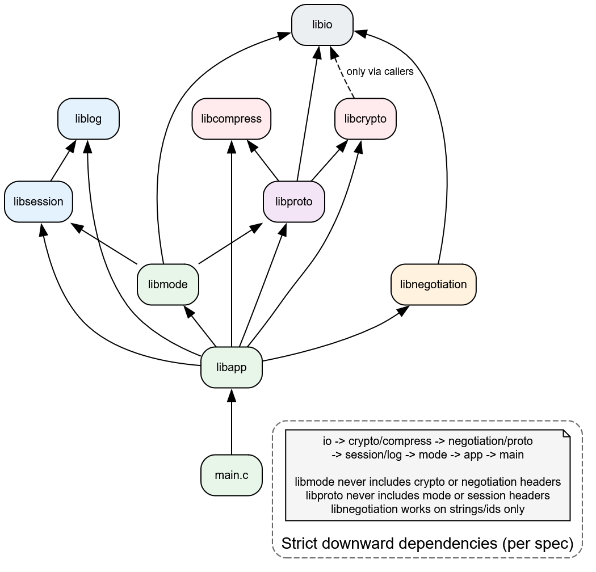
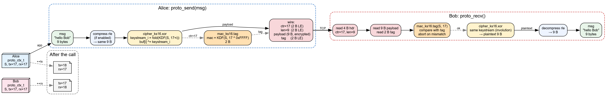
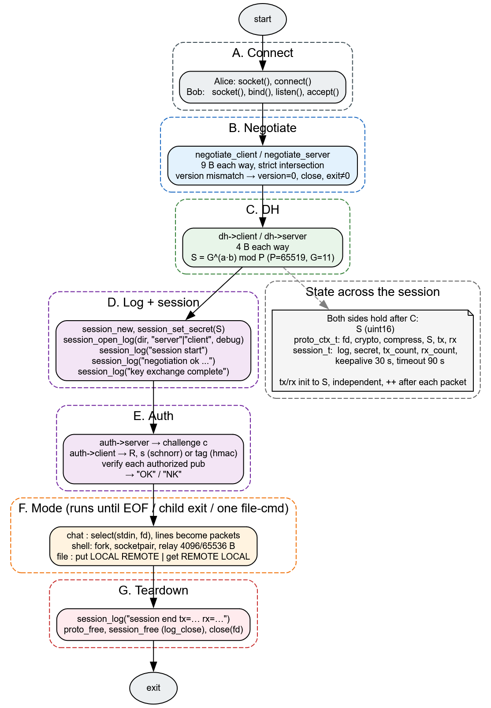
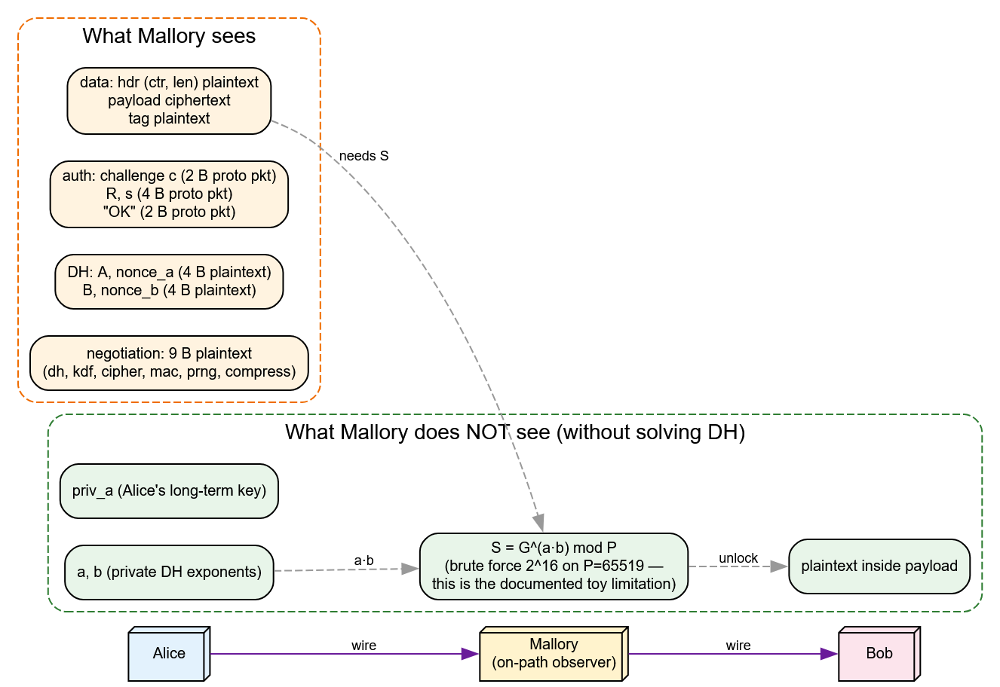
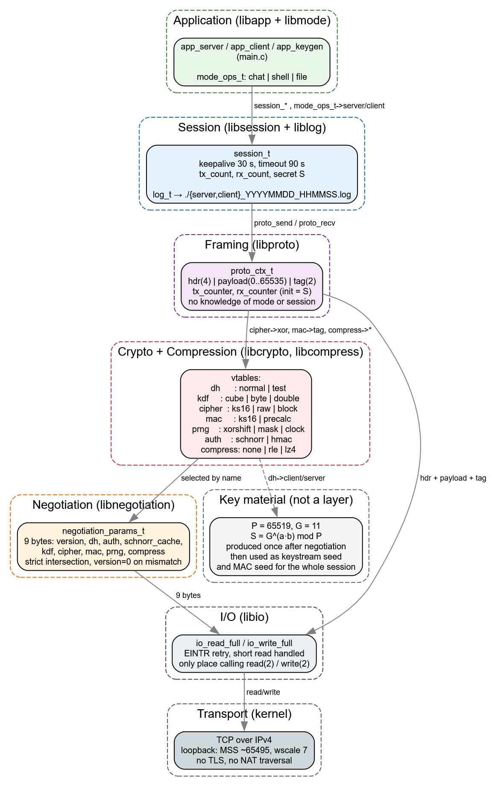

# Curious

Architecture written from scratch, to implement independent layers and steps in queue.

# securetelnet

A toy secure remote shell, chat and file transfer tool over TCP. Written in C99 with 16-bit arithmetic and no external crypto libraries (liblz4 optional).

## Build

```
make
```

Produces `securetelnet`, static libs (`libio.a` … `libapp.a`), test binaries, and benchmarks.

## Usage

```
./securetelnet keygen PRIV PUB
./securetelnet server PORT AUTHORIZED_KEYS [options]
./securetelnet client HOST PORT PRIVATE_KEY [options]
```

Examples:

```
./securetelnet keygen keys/mykey keys/mykey.pub
./securetelnet server 4444 keys/mykey.pub --mode chat
./securetelnet client 127.0.0.1 4444 keys/mykey --mode chat
```

File mode:

```
./securetelnet server 4444 keys/mykey.pub --mode file --compress rle &
./securetelnet client 127.0.0.1 4444 keys/mykey --mode file --file-cmd "put a.txt b.txt"
```

## Modes

- `chat` — interactive chat (default)
- `shell` — remote shell via `--shell /bin/sh`
- `file` — one `put LOCAL REMOTE` or `get REMOTE LOCAL`

## Options

See `./securetelnet --help` for the runtime-generated list of algorithms and defaults.

## Tests

```
make tests
./test_io
./test_crypto
./test_compress
./test_negotiation
./test_proto
./test_session
./test_mode_file
./test_help
bash tests/run_file_tests.sh
```

## Globals

- `crypto_G` — generator found at startup (see `src/main.c` self-test)
- `crypto_P`, `crypto_D_INV` — constants (`FIELD_P=65519`, `FIELD_D_INV=43679`)
- `mode_list`, `dh_list`, `kdf_list`, `cipher_list`, `mac_list`, `prng_list`, `auth_list`, `compress_list` — per-library registries (static, exposed only via find/first/next)
```

That completes the tree. Build with `make`, then run `./securetelnet` (no args) to see the runtime-generated help, and `bash tests/run_file_tests.sh --size 32768` to exercise file transfer.
```






